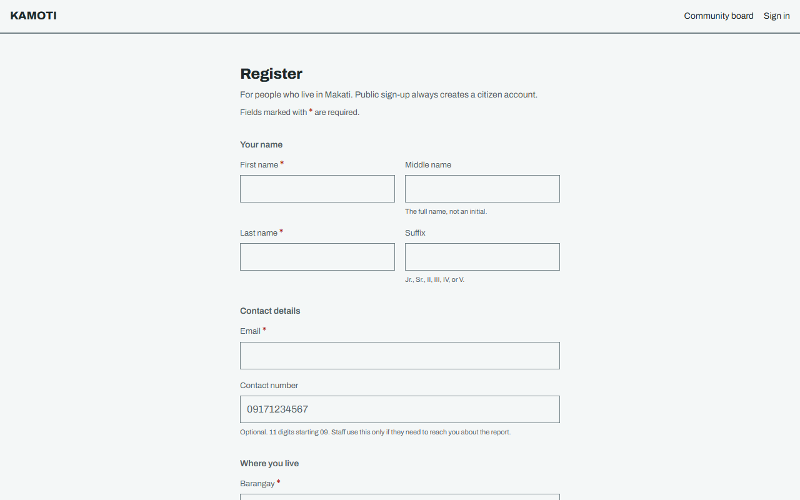
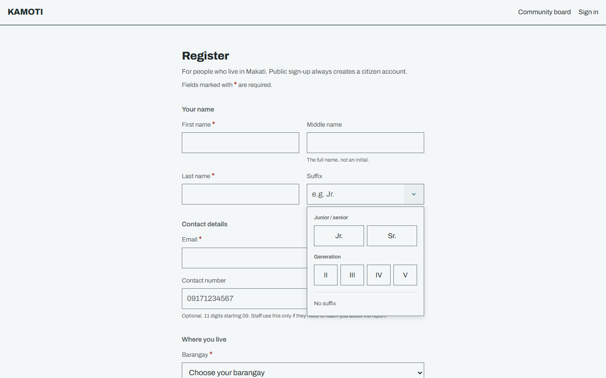
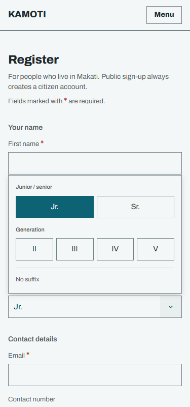

# Grouped suffix suggestions

The user selected option B after comparing three local prototypes. The shared
suffix field now shows Jr./Sr. above II/III/IV/V, with a No suffix action.
Typing, optional input, the existing six values, and caller canonicalization
remain intact. The original note was "Suffix should be typable drop the
optional text because of the asterisk".

The production change is shared by Register, My account editing, and admin
account creation. Prototype variants, seeded display names, the switcher, and
disabled account actions are absent from this branch. The comparison remains
on the separate local branch `prototype/suffix-dropdowns` at `b345707`.

## Evidence

The same menu scenario was run against the former component from baseline
`a0c9696503569155b3bfaa5bf1cb03c83326da99`. It failed waiting for Show suffix
options, which the browser datalist did not provide. With the grouped control,
all four focused browser scenarios passed.

| Before | After on desktop | After at 375px |
| --- | --- | --- |
|  |  |  |

Checked through the real UI with simulated API responses:

- Every supported choice is visible when the full menu opens. Selection closes
  the menu and returns focus to the input. Layout fits 320, 375, 414, 768, and
  1280px widths without horizontal page overflow or a menu outside the viewport.
- Typing filters suggestions. Enter accepts the sole matching suggestion.
  Arrow keys navigate buttons, Home/End reach the ends, and left/right keys in
  the text input still move the caret.
- No suffix clears the field. Escape, outside clicks, and moving focus away
  dismiss the menu. Invalid typed suffixes retain the existing accessible error
  and disabled registration submission.
- My account saves a selected IV through the existing account payload while
  retaining its address. Admin creation submits a selected III.
- All scenarios assert zero page runtime errors.

Checks passed:

```text
bun run typecheck:web
bun run typecheck:test
bun test tests/fast/account-fields.test.ts       # 2 passed
bunx playwright test --config playwright.suffix.config.ts  # 4 passed
bun run build:web
git diff --check
```

The focused suite starts and stops its own Vite server on strict port 5416.
All API calls are intercepted by the scenarios; no API process or database
writes are required. Set `PLAYWRIGHT_CHROMIUM_EXECUTABLE_PATH` to an available
browser when the Playwright-managed Chromium is not installed. Setting
`SUFFIX_BASELINE=1` runs the old component for the failing comparison.

A fresh GPT-6.1-Sol medium review found no high-priority application defects
and no added comments or suppressions requiring correction. The reviewer did
not rerun browser checks. Physical mobile keyboards and hosted persistence
were not tested. The full local test suite and server build were not run for
this frontend-only change.

The earlier prototype process was stopped after verifying its command line.
The focused browser runner completed and stopped its server; ports 5415,
5416, and 4416 had no listeners at the cleanup check.
